<div dir="rtl">

<div align="center">


# Hyundai Smart Companion

مساعد للسيارة مبني على ESP32: شاشة، ساعة، حساسات، صوت عربي، وقراءة بيانات السيارة من OBD-II عبر البلوتوث.

<p>


</p>

[القطع](#القطع) • [التوصيل](#التوصيل) • [التثبيت](#التثبيت) • [الإعدادات](#الإعدادات) • [الأصوات](#الأصوات) • [الأوامر](#أوامر-serial) • [الكيس](#تصميم-الكيس-للطباعة-ثلاثية-الأبعاد) • [حل المشاكل](#حل-المشاكل)

</div>

---

## نبذة

الجهاز يُركّب في السيارة ويعرض الوقت والتاريخ وحرارة المقصورة. عند توصيل قطعة ELM327 بمنفذ OBD يقرأ السرعة وRPM وحرارة ماء المحرك وحرارة الهواء الخارجي وجهد البطارية.

بنيته على سيارة هيونداي، لكنه يعمل على أغلب السيارات التي فيها منفذ OBD-II بتعديلات بسيطة في `config.h`، وهي موضحة في قسم [الإعدادات](#الإعدادات).

- عند التشغيل يرحّب بصوت عربي ثم ينطق اليوم والتاريخ. الأصوات كلها موجودة في المشروع (368 ملفاً).
- يعطي تنبيهات لحرارة المحرك، وتجاوز السرعة، والاهتزاز، وحرارة المقصورة، والاستراحة بعد 30 دقيقة قيادة. كل تنبيه له رمز وعنوان عربي على الشاشة ونغمة حسب مستواه.
- التنبيه لا ينطلق من قراءة واحدة: يحتاج قراءات متتالية فوق الحد، ولا يتكرر إلا بعد أن تنزل القيمة تحت حد الرجوع.
- OBD يعمل في مهمة منفصلة. إذا انقطع، تكمل الشاشة والساعة والحساسات عملها، ويعيد الاتصال وحده.
- فيه Watchdog، وإعادة تهيئة لكل قطعة على حدة، وتحرير لناقل I2C إذا علق، وإصلاح للساعة إذا فقدت الوقت أثناء التشغيل، وسجل تشخيص يتجمع عبر المشاوير.
- الأوامر تُرسل من Serial Monitor أو من الجوال عبر BLE.

---

## الشاشات

الصور التالية مولّدة بنفس الخطوط وطريقة الرسم في الكود، فهي مطابقة لما يظهر على الشاشة. الشاشة ثنائية اللون في العتاد: أعلى 16 صفاً أصفر والباقي أزرق.

<table>
<tr>
<td align="center">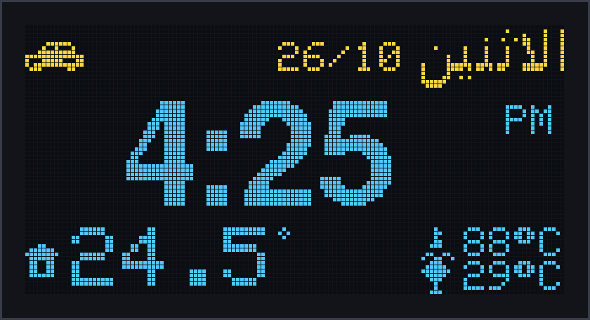<br><b>الشاشة العادية</b><br><sub>الوقت، اليوم، حرارة المقصورة، حرارة الماء والخارج</sub></td>
<td align="center">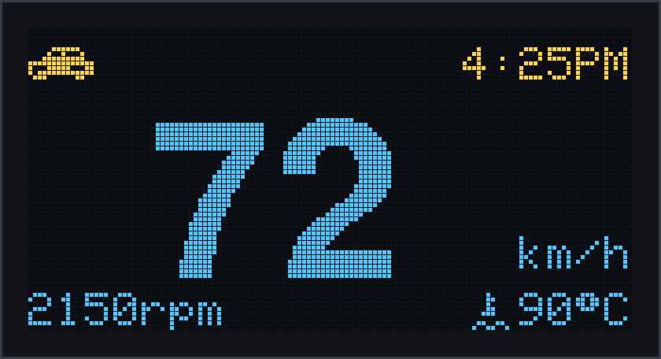<br><b>وضع القيادة</b><br><sub>فوق 5 كم/س تكبر السرعة</sub></td>
</tr>
</table>

### التنبيهات

<table>
<tr>
<td align="center">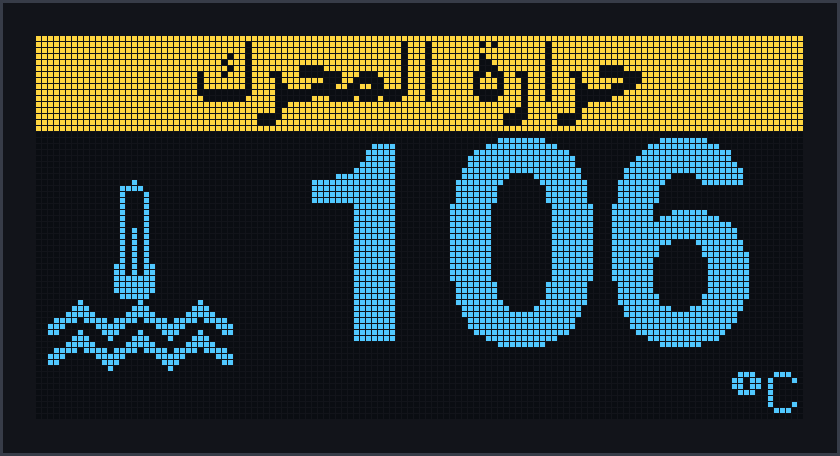<br><b>حرارة المحرك</b><br><sub>حرج، يبقى ظاهراً</sub></td>
<td align="center">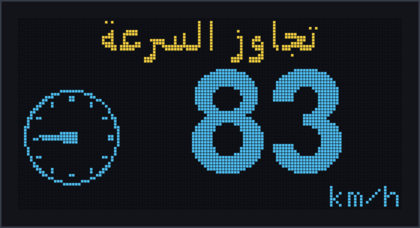<br><b>تجاوز السرعة</b><br><sub>مرة لكل تجاوز</sub></td>
<td align="center">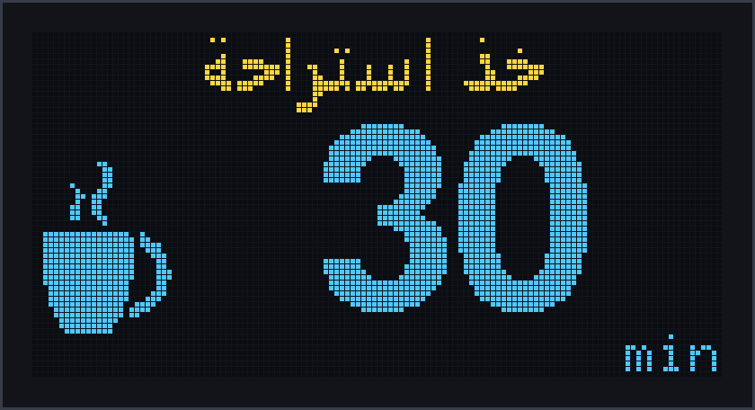<br><b>الاستراحة</b><br><sub>بعد 30 دقيقة قيادة</sub></td>
</tr>
<tr>
<td align="center">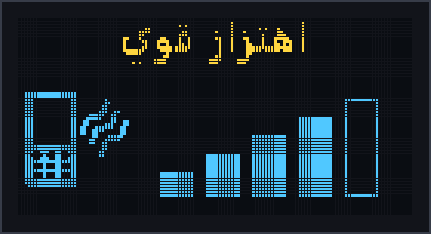<br><b>اهتزاز قوي</b><br><sub>الشدة بأعمدة</sub></td>
<td align="center">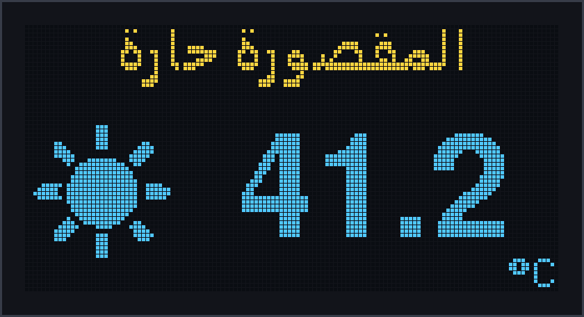<br><b>المقصورة حارة</b><br><sub>فوق 40°C</sub></td>
<td align="center">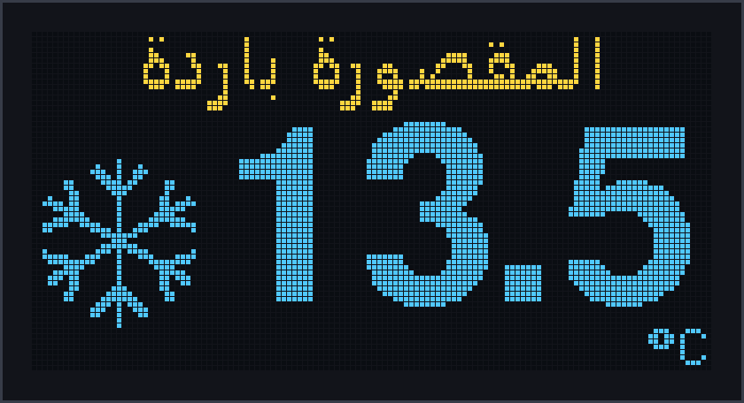<br><b>المقصورة باردة</b><br><sub>تحت 15°C</sub></td>
</tr>
</table>

| المستوى | التنبيه | الشرط | الصوت |
|:---:|---|---|---|
| 1 حرج | حرارة المحرك | 105°C أو أكثر في 3 قراءات متتالية | تنبيه عالي، يتكرر كل 5 دقائق |
| 2 تحذير | تجاوز السرعة | 80 كم/س أو أكثر في قراءتين | تنبيه متوسط |
| 2 تحذير | اهتزاز قوي | والسيارة واقفة فقط | تنبيه متوسط |
| 2 تحذير | حرارة المقصورة | فوق 40°C أو تحت 15°C | تنبيه متوسط، مرة لكل تشغيل |
| 3 تذكير | الاستراحة | 30 دقيقة قيادة | تنبيه بسيط |

### رموز شريط الحالة

<p align="center">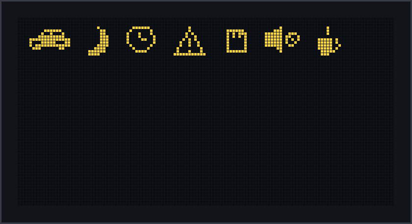</p>

| الرمز | المعنى |
|:---:|---|
| سيارة | OBD متصل |
| قمر | OBD متصل والسيارة مطفأة |
| سيارة مشطوبة | OBD غير متصل |
| ساعة | الوقت غير مضبوط |
| مثلث | عطل في حساس أو إعادة تشغيل غير طبيعية |
| بطاقة | بطاقة الصوت غير موجودة |
| سماعة مشطوبة | DFPlayer لا يرد |
| كوب | وقت الاستراحة |

---

## القطع

| # | القطعة | الوظيفة | الاتصال |
|:---:|---|---|---|
| 1 | **ESP32** مع شاشة **OLED 128×64** مدمجة (ثنائية اللون) | المعالج والشاشة | مدمجة |
| 2 | **PCF8563** + بطارية CR2032 | الساعة | I2C ‏`0x51` |
| 3 | **AHT20 + BMP280** (لوحة واحدة) | الحرارة والرطوبة والضغط | I2C ‏`0x38` / `0x77` |
| 4 | **HW-072** | حساس اهتزاز | GPIO27 |
| 5 | **DFPlayer Mini** + بطاقة microSD | تشغيل الأصوات | UART2 |
| 6 | سماعة **3W** (4–8Ω) | الصوت | DFPlayer |
| 7 | مقاومة **1kΩ** | على خط RX للـ DFPlayer | GPIO17 |
| 8 | **ELM327 v2.1** بلوتوث | بيانات السيارة | بلوتوث Classic |
| 9 | **شاحن USB للسيارة** + سلك USB | التغذية 5V | سلك مقطوع |
| 10 | مكثف **470–1000µF / 10V** | لثبات الجهد (موصى به) | 5V ↔ GND |

---

## التوصيل

<p align="center">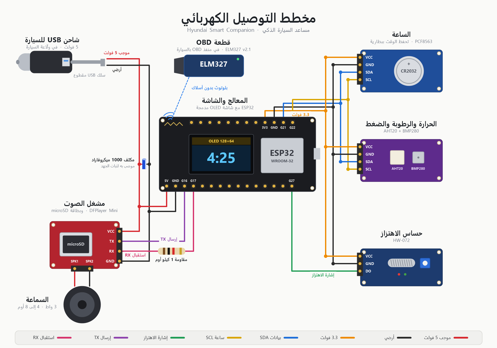</p>

<details open>
<summary><b>جدول التوصيل</b></summary>

#### ناقل I2C (كل القطع على نفس الأسلاك)

| القطعة | VCC | GND | SDA | SCL |
|---|:---:|:---:|:---:|:---:|
| شاشة OLED | مدمجة في اللوحة | | | |
| PCF8563 | 3.3V | GND | GPIO21 | GPIO22 |
| AHT20 + BMP280 | 3.3V | GND | GPIO21 | GPIO22 |

#### الاهتزاز HW-072

| HW-072 | ESP32 |
|:---:|:---:|
| VCC | 3.3V |
| GND | GND |
| DO | **GPIO27** |

#### DFPlayer Mini

| DFPlayer | يوصل إلى | ملاحظة |
|:---:|:---:|---|
| VCC | **5V** | من سلك USB مباشرة |
| GND | GND | أرضي مشترك |
| TX | **GPIO16 (RX2)** | مباشرة |
| RX | **GPIO17 (TX2)** | عبر مقاومة **1kΩ** |
| SPK1 / SPK2 | السماعة | لا توصل أي طرف منهما بـ GND |

#### ELM327
بدون أسلاك. تُركّب في منفذ OBD بالسيارة، والاتصال بالبلوتوث.

</details>

### التغذية

أستخدم شاحن USB للسيارة مع سلك USB مقطوع: الأحمر +5V والأسود GND.

```
شاحن USB (يعمل مع سويتش السيارة)
        │
   سلك USB مقطوع
   ├── أحمر (+5V) ──► 5V في ESP32  +  VCC في DFPlayer
   └── أسود (GND) ──► GND في ESP32 +  GND في DFPlayer   (أرضي واحد مشترك)

3.3V من لوحة ESP32 ──► الساعة + AHT20/BMP280 + HW-072
```

> [!WARNING]
> لا توصل 12V مباشرة بلوحة ESP32 أو بالـ DFPlayer. وغذِّ الـ DFPlayer من **5V** وليس 3.3V: على مستوى الصوت 30 يسحب تياراً عالياً، وعلى خط 3.3V كان يُهبط الجهد فتنفصل بطاقة الذاكرة، وفقدت الساعة الوقت مرة.

> [!TIP]
> مكثف 470–1000µF قريب من الـ DFPlayer (بين VCC وGND) يساعد على ثبات الجهد، ومنها لحظة تشغيل المحرك.

---

## التثبيت

> [!CAUTION]
> استخدم حزمة ESP32 إصدار **3.3.x** ولا تحدّث إلى **4.x**، لأن مكتبة `BluetoothSerial` التي يستخدمها OBD غير موجودة فيه.

1. **Arduino IDE** مع حزمة **esp32 by Espressif** إصدار **3.3.x**.

2. **المكتبات** (من Library Manager):

   | المكتبة | الإصدار المجرّب |
   |---|:---:|
   | Adafruit SSD1306 | 2.5.17 |
   | Adafruit GFX Library | 1.13.0 |
   | Adafruit BMP280 Library | 3.0.0 |
   | Adafruit BusIO / Unified Sensor | 1.17.4 / 1.1.15 |
   | RTClib | 2.1.4 |

   تعريفا AHT20 وDFPlayer مكتوبان داخل المشروع، فلا تحتاج مكتبتيهما.

3. **إعدادات اللوحة** من قائمة Tools:
   - Board: **ESP32 Dev Module**
   - Partition Scheme: **Huge APP (3MB No OTA/1MB SPIFFS)**. ضروري لأن البرنامج مع البلوتوث حوالي 1.2MB.

4. **بطاقة الذاكرة:** FAT32، وانسخ مجلد **`SD_card/mp3`** إلى جذرها (`/mp3/0001.mp3` ...).

5. **عدّل `config.h`** حسب قطعتك وسيارتك (القسم التالي).

6. **ارفع** مجلد `HyundaiCompanion`. الساعة تنضبط تلقائياً من وقت الترجمة، ولضبطها بدقة اكتب في Serial Monitor: `SET 2026-10-26 16:25:00`

---

## الإعدادات

كل الإعدادات في **`HyundaiCompanion/config.h`**.

### لازم تغيّرها

| الإعداد | القيمة الحالية | ماذا تضع |
|---|---|---|
| `OBD_MAC` | `{0x00,0x10,0xCC,0x4F,0x36,0x03}` | عنوان قطعة ELM327 عندك (انظر بالأسفل) |
| `OBD_PIN` | `"1234"` | رمز قطعتك (غالباً `1234` أو `0000`) |
| `BT_DEVICE_PIN` | 16 رقماً | رمز خاص بك بدل الموجود |
| `BT_DEVICE_NAME` | `"BT-AUX-27"` | اسم الجهاز في البلوتوث |
| `BLE_PASSKEY` | 6 أرقام | رمز اقتران الجوال (انظر [التحكم من الجوال](#التحكم-من-الجوال)) |

<details>
<summary><b>كيف أعرف عنوان قطعة OBD (MAC)؟</b></summary>

- ارفع كود الاختبار **`tests/test_elm327`**، فيبحث عن الأجهزة ويطبع عناوينها في Serial Monitor.
- أو من الجوال بأي تطبيق بحث بلوتوث، ابحث عن جهاز اسمه **OBDII** أو **OBD2**.
- القطعة تقبل اتصالاً واحداً، فافصل الجوال عنها قبل التجربة.

</details>

### حسب سيارتك

| الإعداد | الافتراضي | المعنى |
|---|:---:|---|
| `SPEED_OFFSET_KMH` | `7` | فرق عداد السيارة عن OBD (العداد يقرأ أعلى). `0` = السرعة الحقيقية |
| `SPEED_ALERT_KMH` / `SPEED_REARM_KMH` | `80` / `75` | حد تنبيه السرعة وحد الرجوع |
| `COOLANT_ALERT_C` | `105` | حد حرارة المحرك |
| `CABIN_HOT_C` / `CABIN_COLD_C` | `40` / `15` | حرارة المقصورة |
| `REST_REMINDER_MS` | 30 دقيقة | تذكير الاستراحة |
| `DF_VOLUME` | `30` | مستوى الصوت (0–30) |
| `DISPLAY_24H` | `false` | `true` لنظام 24 ساعة |
| `SAY_DATE_WITH_GREETING` | `true` | نطق التاريخ بعد الترحيب |
| `VIB_STRONG_COUNT` | `24` | حساسية الاهتزاز (عايرها بأمر `VIB`) |

### الاسم والشعار

| ماذا | أين | كيف |
|---|---|---|
| الاسم في الترحيب الصوتي | `SD_card/mp3_untrimmed/0004.mp3` | سجّل اسمك واستبدل الملف، ثم شغّل `tools/build_phrases.ps1` |
| كلمة HYUNDAI في شاشة الترحيب | `tools/gen_bitmaps.ps1` (سطر `WORDMARK`) | اكتب ماركة سيارتك وشغّل الأداة |
| أسماء الأيام والعناوين العربية | `tools/gen_bitmaps.ps1` | عدّل النص وشغّل الأداة، فيتحدث `bitmaps.h` |

<details>
<summary><b>المنافذ (إذا وصّلت بشكل مختلف)</b></summary>

| الإعداد | الافتراضي |
|---|:---:|
| `PIN_I2C_SDA` / `PIN_I2C_SCL` | 21 / 22 |
| `PIN_VIBRATION` | 27 |
| `PIN_DF_RX` / `PIN_DF_TX` | 16 / 17 |
| `ADDR_BMP280_A` | `0x77` (احتياط `0x76`) |

</details>

---

## الأصوات

مجلد **[`SD_card`](SD_card)** جاهز للنسخ على البطاقة، ويمكن استخدامه في مشاريع أخرى تحتاج أصواتاً عربية للوقت والتاريخ.

```
SD_card/
├── mp3/                  ← انسخه إلى البطاقة كما هو (368 ملفاً، حوالي 6.4MB)
├── mp3_untrimmed/        ← الأصل قبل قص الصمت (مصدر أداة الدمج)
└── جدول_الأصوات.csv      ← كل رقم وماذا يقول
```

الـ DFPlayer يشغّل الملف برقمه (`/mp3/0025.mp3`)، والكود يحسب الرقم بمعادلة:

<details>
<summary><b>جدول الترقيم</b></summary>

| الأرقام | المحتوى | المعادلة |
|:---:|---|:---:|
| 0001–0006 | صباح/مساء الخير، يا، الاسم، صباحاً، مساءً | ثابت |
| 0010–0012 | نغمات التنبيه (بسيط، متوسط، عالي) | ثابت |
| 0040–0046 | الأحد ← السبت | 40 + اليوم |
| 0050–0054 | الساعة الآن، اليوم هو، تاريخ اليوم هو، من، و | ثابت |
| 0061–0072 | يناير ← ديسمبر | 60 + الشهر |
| 0081–0092 | الساعة الواحدة ← الثانية عشرة | 80 + الساعة |
| 0101–0159 | دقيقة واحدة ← تسع وخمسون دقيقة | 100 + الدقيقة |
| 0226–0228 | 2026 ← 2028 | 200 + (السنة − 2000) |
| 0301–0331 | الأول ← الحادي والثلاثون | 300 + اليوم |
| **0401–0992** | **جمل مدمجة مسبقاً** (الترحيب كاملاً، «و خمس دقائق مساءً»، «تاريخ اليوم هو...») | انظر `جدول_الأصوات.csv` |

</details>

### تجهيز أصوات جديدة

ضع تسجيلاتك في `SD_card/mp3_untrimmed` بنفس أرقام `جدول_الأصوات.csv`، ثم:

| الخطوة | الأداة | ماذا تفعل |
|:---:|---|---|
| 1 | `tools/trim_silence.ps1` | يقص الصمت من بداية ونهاية كل ملف بدون إعادة ترميز، والناتج في `SD_card/mp3` |
| 2 | `tools/build_phrases.ps1` | يدمج الأجزاء الثابتة من الجمل في ملف واحد |

<div dir="ltr">

```powershell
powershell -ExecutionPolicy Bypass -File tools\trim_silence.ps1 SD_card\mp3_untrimmed SD_card\mp3
powershell -ExecutionPolicy Bypass -File tools\build_phrases.ps1
```

</div>

> [!NOTE]
> الـ DFPlayer يتوقف لحظة عند فتح كل ملف، لذلك الجمل مدمجة مسبقاً: الترحيب ملف واحد، والوقت ملفان، والتاريخ 3 ملفات. ولا تُكثر عدد الملفات: مع حوالي 1800 ملف لم تستطع القطعة الإقلاع.

---

## بنية المشروع

```
HyundaiCompanion/
├── HyundaiCompanion.ino   ← التنسيق، أوامر Serial، سجل التشخيص
├── config.h               ← الإعدادات
├── data_model.h           ← البيانات المشتركة وقاعدة القيمة الصالحة
├── sensors.cpp/.h         ← الساعة + AHT20 + BMP280 + الاهتزاز
├── obd.cpp/.h             ← مهمة OBD (بلوتوث ELM327)
├── display.cpp/.h         ← الواجهات والرموز
├── audio.cpp/.h           ← DFPlayer وطابور الأولويات
├── alerts.cpp/.h          ← التنبيهات وجلسة القيادة
├── ble_console.cpp/.h     ← الأوامر من الجوال عبر BLE
└── bitmaps.h              ← النصوص العربية والرموز (مولّد)
tools/                     ← أدوات الأصوات والصور (PowerShell)
SD_card/                   ← الأصوات الجاهزة
3dfile/                    ← ملفات الكيس للطباعة
docs/images/               ← صور README
tests/                     ← أكواد اختبار كل قطعة منفردة
```

### أكواد الاختبار

قبل تجميع الجهاز جرّبت كل قطعة لوحدها بكود صغير. كل اختبار مشروع Arduino مستقل، افتحه وارفعه مباشرة.

| المجلد | يختبر |
|---|---|
| `tests/test_i2c_scanner` | يفحص ناقل I2C ويطبع عناوين القطع، ويجرب مكتبة كل قطعة |
| `tests/test_rtc_oled` | الساعة PCF8563 مع الشاشة |
| `tests/test_aht20_bmp280` | الحرارة والرطوبة والضغط (يحتاج مكتبة Adafruit AHTX0) |
| `tests/test_vibration` | حساس الاهتزاز HW-072 |
| `tests/test_dfplayer` | تشغيل ملف صوت من DFPlayer (يحتاج مكتبة DFRobotDFPlayerMini) |
| `tests/test_elm327` | الاتصال بقطعة ELM327 وقراءة OBD |

<details>
<summary><b>كيف يعمل</b></summary>

- **مساران منفصلان:** الحلقة الرئيسية (الساعة، الحساسات، الشاشة، الصوت) لا تنتظر OBD. OBD مهمة FreeRTOS على النواة 0 وتكتب قيمها في بيانات مشتركة محمية بـ Mutex.
- **القيمة الصالحة:** كل قيمة معها حالة صلاحية ووقت آخر تحديث. القيمة القديمة تظهر `--` وليس `0`، لأن السرعة 0 تعني أن السيارة واقفة.
- **السيارة مطفأة:** إذا ردّت السيارة `NO DATA` يتوقف الطلب حتى لا يوقظ وحدات التحكم ويستهلك البطارية.
- **البلوتوث:** اتصال OBD على البلوتوث العادي ومخفي (الجهاز هو من يتصل بالقطعة)، أما الجوال فيتصل عبر BLE برمز اقتران.

</details>

---

## أوامر Serial

افتح Serial Monitor على **115200** واختر **Both NL & CR**:

| الأمر | الوظيفة |
|---|---|
| `STATUS` | حالة كل القطع والقيم |
| `DIAG` | سجل التشخيص عبر كل المشاوير (إعادات التشغيل، مدة التشغيل، الذاكرة) |
| `SET 2026-10-26 16:25:00` | ضبط الساعة |
| `TIME` | الوقت الحالي في الجهاز |
| `SAY HELLO` / `SAY TIME` / `SAY DATE` | نطق الترحيب / الوقت / التاريخ |
| `ALERTTEST 1..6` | عرض كل تنبيه بشاشته ونغمته للتجربة |
| `OBD` / `OBDRAW` / `OBD 0105` | حالة OBD / طباعة كل أمر ورده / أمر يدوي (قراءة فقط) |
| `VIB` | قراءة حساس الاهتزاز لحظياً (للمعايرة) |
| `TESTSND` / `VOL n` / `LOG 0-3` | تجربة كل الأصوات / مستوى الصوت / مستوى السجلات |

<details>
<summary>بقية الأوامر</summary>

`PLAY n` · `TONE 1-3` · `STOP` · `OBDGAP ms` · `ALERTS` · `SESSION min` · `DIAG RESET` · `HELP`

</details>

---

## التحكم من الجوال

نفس أوامر Serial تعمل من الجوال، وأكثر ما أستخدمها له ضبط الوقت.

1. حمّل تطبيق **Serial Bluetooth Terminal** (أندرويد) أو **LightBlue** (آيفون).
2. من قائمة أجهزة **BLE** اختر **`BT-AUX-27`**.
3. أدخل رمز الاقتران (`BLE_PASSKEY` في `config.h`). الجهاز يتذكر الجوال بعد أول مرة.
4. أرسل الأمر، مثلاً `SET 2026-10-28 15:30:00` ثم `TIME` للتأكد.

> [!NOTE]
> اتصال OBD يبقى على البلوتوث العادي ومخفياً، والجوال على BLE منفصل. بدون الرمز لا يُقبل أي أمر، والاتصال مشفر.

---

## تصميم الكيس للطباعة ثلاثية الأبعاد

الصور التالية مأخوذة من ملفات STL الموجودة في مجلد [`3dfile`](3dfile)، وهي تصميم الكيس الخاص بالمشروع.

<table>
<tr>
<td align="center">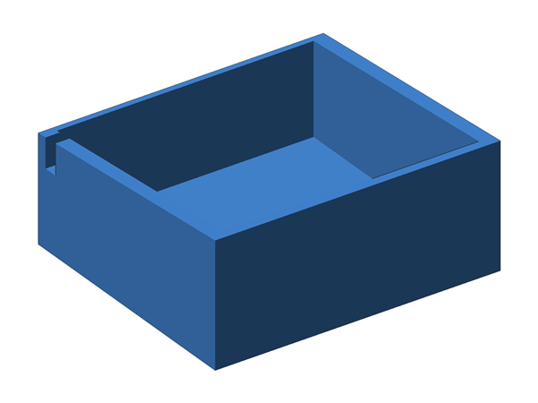<br><b>الكيس</b><br><sub><code>case.stl</code></sub></td>
<td align="center">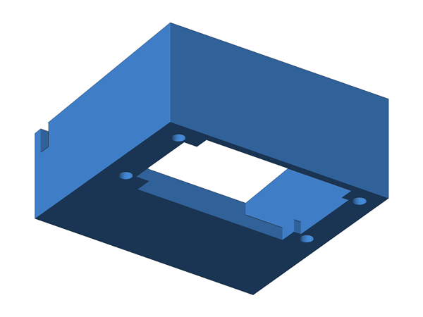<br><b>الكيس من الأسفل</b><br><sub><code>case.stl</code></sub></td>
</tr>
<tr>
<td align="center">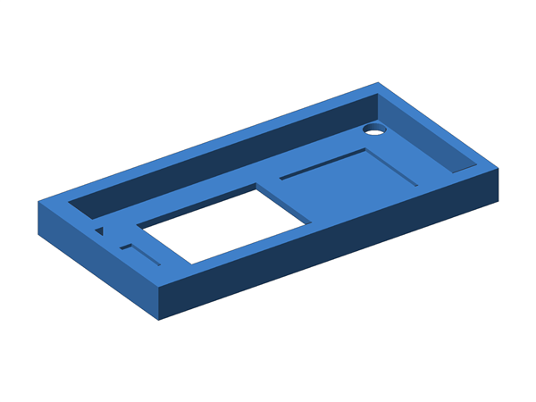<br><b>الغطاء الأمامي (ESP32 والشاشة)</b><br><sub><code>frontcaver.stl</code></sub></td>
<td align="center">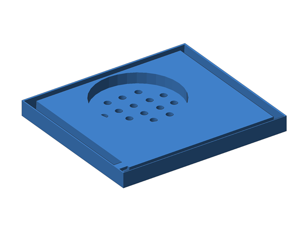<br><b>الغطاء الخلفي (السماعة)</b><br><sub><code>backcaver.stl</code></sub></td>
</tr>
</table>

| الملف | القطعة | الأبعاد التقريبية |
|---|---|---|
| [`3dfile/case.stl`](3dfile/case.stl) | الكيس، مفتوح من الأعلى وفي قاعدته فتحة وثقوب تثبيت | 71 × 63 × 31 مم |
| [`3dfile/frontcaver.stl`](3dfile/frontcaver.stl) | الغطاء الأمامي، يُثبّت عليه ESP32 وفيه فتحة للشاشة | 71 × 36 × 7 مم |
| [`3dfile/backcaver.stl`](3dfile/backcaver.stl) | الغطاء الخلفي، يُثبّت عليه السماعة وفيه فتحات الصوت | 72 × 64 × 6 مم |

---

## حل المشاكل

<details>
<summary><b>«SD removed» أو انقطاع الصوت مع النغمات العالية</b></summary>

هبوط في الجهد: الـ DFPlayer على 3.3V أو بدون مكثف. غذِّه من **5V** وضع مكثف 470–1000µF قريباً منه.
</details>

<details>
<summary><b>الوقت يظهر <code>--:--</code></b></summary>

الساعة فقدت الوقت والجهاز مطفأ (بطارية ضعيفة أو هبوط جهد). اكتب `SET` مرة واحدة. إذا فُقد الوقت أثناء التشغيل يعيد الجهاز ضبطه من ساعته الداخلية.
</details>

<details>
<summary><b>OBD لا يتصل</b></summary>

- تأكد من `OBD_MAC` و`OBD_PIN`.
- افصل الجوال عن القطعة (تقبل اتصالاً واحداً).
- جرّب `BT_USE_OWN_PIN = false` في `config.h`.
- `OBDRAW` يطبع كل أمر ورده.
</details>

<details>
<summary><b>DFPlayer: no response</b></summary>

غالباً سلك **TX** للـ DFPlayer: يجب أن يذهب إلى **RX2 (GPIO16)** لأن التوصيل متقاطع. ولا تستخدم TX0/RX0.
</details>

<details>
<summary><b>كل قطع I2C فشلت معاً</b></summary>

سلكان متلامسان أو الناقل عالق. افحص التوصيل؛ الجهاز يحاول تحرير الناقل بعد 3 ثوانٍ.
</details>

<details>
<summary><b>البرنامج لا يدخل في الذاكرة عند الرفع</b></summary>

اختر **Partition Scheme: Huge APP**.
</details>

<details>
<summary><b>رمز التحذير يظهر بعد تشغيل المحرك</b></summary>

إعادة تشغيل غير طبيعية، غالباً من هبوط الجهد لحظة تشغيل المحرك. `DIAG` يعرض السبب، والمكثف يساعد غالباً.
</details>

---

## أفكار لم تُنفذ بعد

- [ ] مراقبة البطارية والشحن (الدينمو) من `ATRV`
- [ ] تنبيه المحرك البارد قبل التسارع العالي
- [ ] قراءة أكواد الأعطال (`03`)، قراءة فقط
- [ ] إحصائيات الرحلة: أعلى سرعة، متوسط، مسافة
- [ ] حد اهتزاز أثناء الحركة (بعد المعايرة)
- [ ] زر واحد: كتم مؤقت، إعادة آخر تنبيه، نطق الوقت
- [ ] وضع ليلي وحساس ضوء لخفض السطوع

</div>
